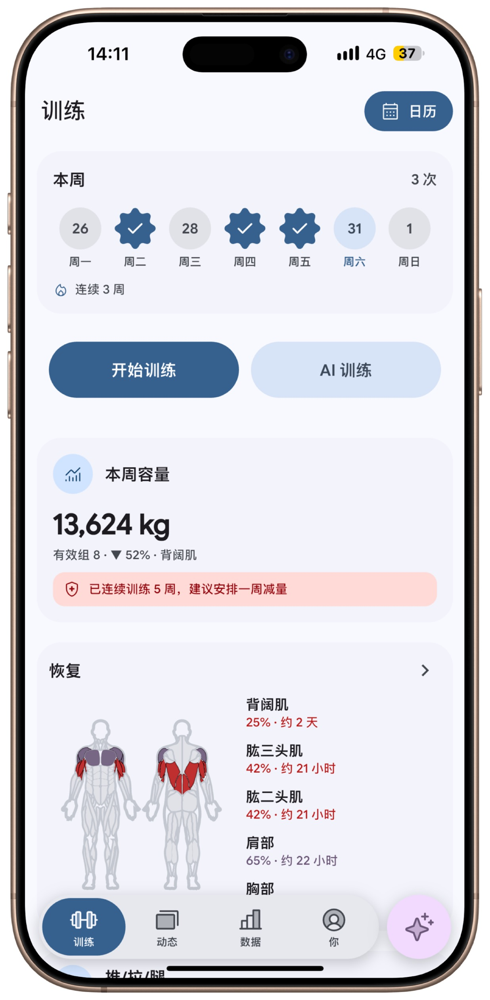
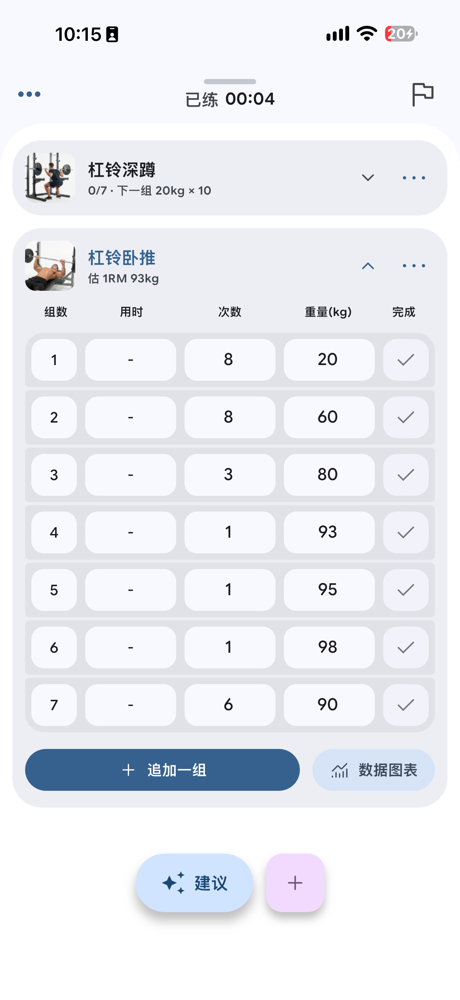
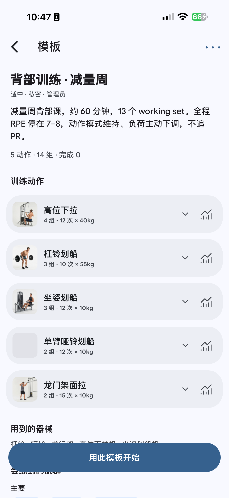
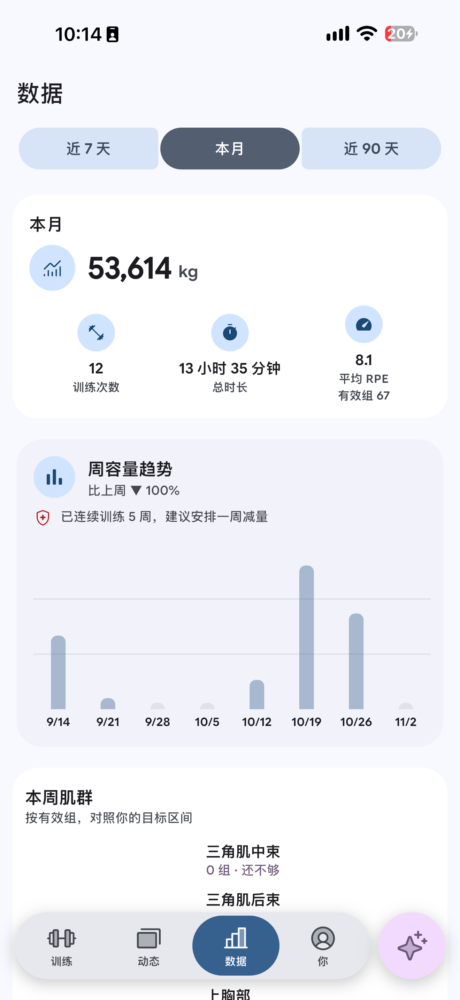
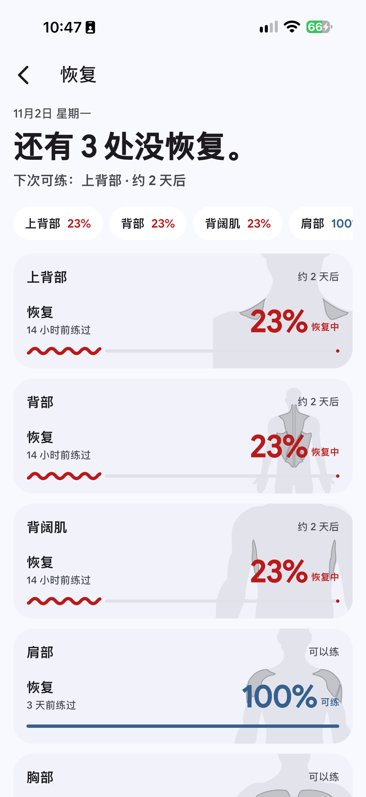
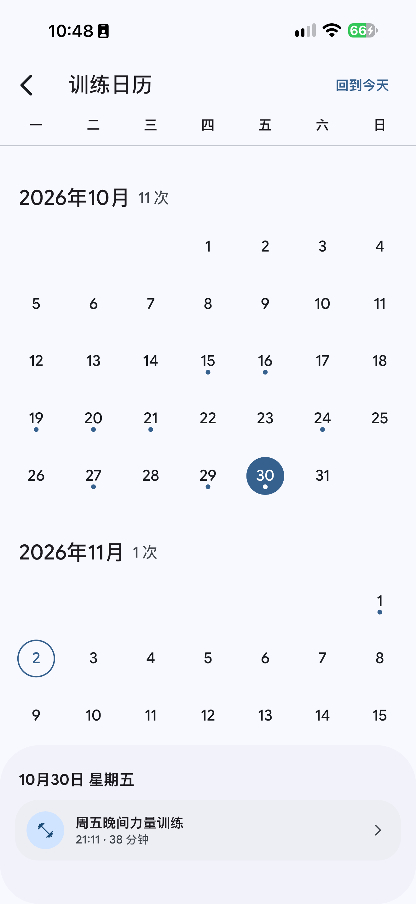
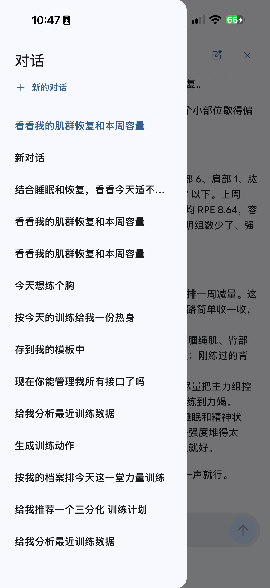
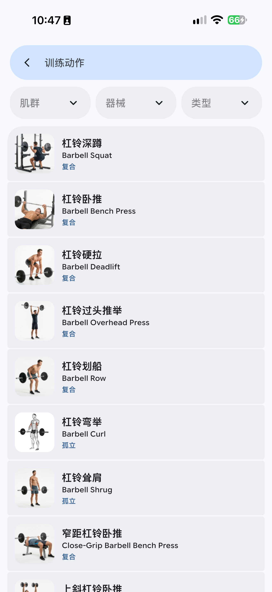
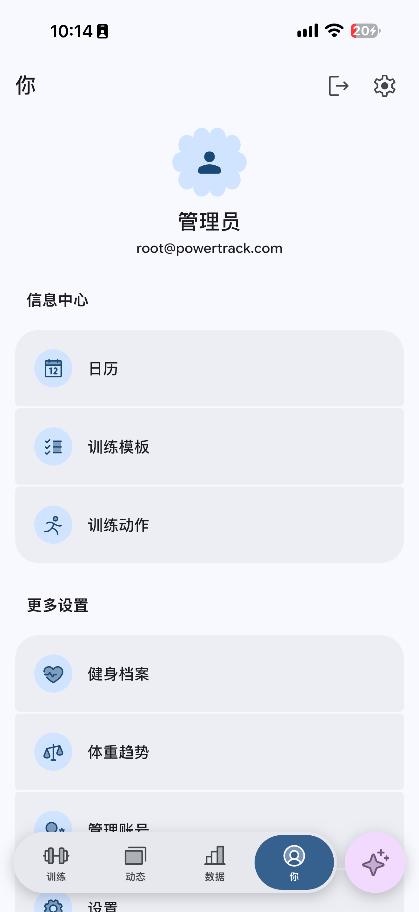

<p align="center">
  <strong>English</strong> · <a href="README.zh-CN.md">中文</a>
</p>

<div align="center">


# PowerTrack

**Self-hosted strength training, with a coach on your key.**

An open-source tracker for people who lift: a Flutter app for iOS and Android, a FastAPI backend, and a React admin. Log every set, watch volume and estimated strength move, and ask an OpenAI-compatible model that can read those sessions. The API key stays on the device. You host the database.

[](LICENSE)
[](https://github.com/Ervin0031/PowerTrack/stargazers)
[](#contributing)

[Why PowerTrack](#why-powertrack) · [Features](#features) · [Screenshots](#screenshots) · [Architecture](#architecture) · [Getting started](#getting-started)

</div>

The phone UI and the coach's replies are Simplified Chinese today. The screenshots below are that interface.

## Screenshots

### Train

<table>
  <tr>
    <td align="center" width="33%">
      
      <br /><sub><b>Training home</b><br />This week, volume, recovery</sub>
    </td>
    <td align="center" width="33%">
      
      <br /><sub><b>Live session</b><br />Sets, reps, weight, estimated 1RM</sub>
    </td>
    <td align="center" width="33%">
      
      <br /><sub><b>Template</b><br />A reusable session you can start</sub>
    </td>
  </tr>
</table>

### Progress

<table>
  <tr>
    <td align="center" width="33%">
      
      <br /><sub><b>Statistics</b><br />Volume, time, RPE, weekly trend</sub>
    </td>
    <td align="center" width="33%">
      
      <br /><sub><b>Recovery</b><br />What is ready, and what is not</sub>
    </td>
    <td align="center" width="33%">
      
      <br /><sub><b>Calendar</b><br />Every finished session, by day</sub>
    </td>
  </tr>
</table>

### Coach, library, profile

<table>
  <tr>
    <td align="center" width="33%">
      
      <br /><sub><b>AI coach</b><br />Your key, your sessions</sub>
    </td>
    <td align="center" width="33%">
      
      <br /><sub><b>Exercise library</b><br />Muscle, equipment, type</sub>
    </td>
    <td align="center" width="33%">
      
      <br /><sub><b>Profile</b><br />Templates, history, body weight</sub>
    </td>
  </tr>
</table>

## Why PowerTrack

PowerTrack is the tracker you run when you want a real training log and a coach, on hardware you control. Cloud gym apps keep the database. A bare self-hosted log usually stops at sets and reps. PowerTrack is the middle: your Postgres, a native phone app, and a model you pay for yourself.

| | PowerTrack | Typical cloud gym app | Plain self-hosted log |
| --- | :---: | :---: | :---: |
| Training data in a database you run | Yes | Their cloud | Yes |
| Native iOS and Android app | Yes | Usually | Rarely |
| AI coach on a key you bring | Yes | Often paid | Usually none |
| Logger still works with no model key | Yes | Yes | Yes |
| Blocks, recovery, estimated 1RM | Yes | Often gated | Rarely |
| Admin for users and the exercise catalog | Yes | Vendor console | Rarely |

With no model key configured, the app is still the logger, the calendar, and the stats. Add a key when you want the coach.

A star on the [repo](https://github.com/Ervin0031/PowerTrack) helps other lifters find it.

## Features

### Log and train

- **Sets as you train them** — reps, weight in kilograms, duration, RPE, and a set type (warm-up, working, drop, cool-down), with a rest timer.
- **Ghost sets** — the last time you did that exercise, shown beside the logger as a reference.
- **Load that follows the work** — a suggested working weight from recent estimated 1RM, and RPE-based adjustments for the next set.
- **Supersets** — exercises that share a superset are grouped in the session.
- **Templates, blocks, prescriptions** — reusable sessions, a training block, and a next-time load for a lift.
- **Crash recovery** — the open session is stored in on-device SQLite, so a restarted app can pick it up.
- **On iOS** — a Live Activity / Dynamic Island for the session in progress, and an Apple Health bridge for steps, active energy, body mass, and resting heart rate. A finished strength session can be written back to Health.

### Progress

- **This week at a glance** — sessions, streak, volume, and a deload hint when the recent weeks say you should ease off.
- **Calendar** — finished sessions by day.
- **Statistics** — volume, time, average RPE, a weekly volume chart, and per-muscle sets against weekly landmark bands.
- **Estimated 1RM** — Epley for 1–10 reps, or an RPE percentage when you log RPE.
- **Strength standards** — strength relative to body weight, squat / bench / deadlift, plus DOTS and Wilks when the profile has gender and body weight.
- **Recovery** — which regions are ready and which still need time.
- **Body and profile** — body-weight history, and a fitness profile with goal, experience, injuries, BMR, TDEE, and a calorie target.

### AI coach (bring your own key)

- **Any OpenAI-compatible endpoint.** The default is DeepSeek (`https://api.deepseek.com/v1`, model `deepseek-flash`). A local `http://localhost` endpoint is allowed for development; other hosts need HTTPS.
- **The key stays on the phone.** It is stored in the iOS Keychain or Android Keystore and is not sent to the PowerTrack API. Chat text is saved on your server so the thread follows the account.
- **Grounded in your log.** The model can read your profile, recovery, recent sessions, templates, exercise stats, and volume, then answer in Simplified Chinese. The composer includes a microphone for dictation and prefers a Chinese recognizer when the device has one.
- **Plans you confirm.** It can propose a session or the next exercise. Starting a proposal opens it as a normal workout. If you ask, it can also create or edit your exercises, templates, and profile, or delete a session you name.
- **Optional server key.** `LLM_API_KEY` on the backend enables a streaming coach endpoint for API clients. The phone app does not use that key. Leave it empty and that endpoint stays disabled.

Coaching text is general training feedback. It is not a diagnosis or a medical prescription.

### Admin and self-host

- **Accounts** — register, verify email, reset or change a password, and review signed-in devices. Auth is a JWT access token plus a refresh token.
- **A feed on your server** — follow other accounts on the same instance, share a finished workout, and comment. Nothing is posted to a third-party network.
- **React admin** — manage users and the exercise catalog (exercises, equipment, muscle groups), including image upload. The dashboard is based on shadcn-admin.
- **The data stack** — PostgreSQL, Redis, Celery (a daily database backup kept for 30 days), and S3-compatible storage (RustFS) for exercise images.
- **A catalog you can import** — optional import from [hasaneyldrm/exercises-dataset](https://github.com/hasaneyldrm/exercises-dataset), matched by English name, with missing demo GIFs filled in.

## Architecture

```
PowerTrack/
├── app/        Flutter client (iOS / Android)
├── backend/    FastAPI + SQLModel + PostgreSQL
├── frontend/   React admin dashboard
├── docs/       Feature notes (Chinese)
└── images/     Screenshots used above
```

| Part | Stack |
| --- | --- |
| `app/` | Flutter 3.47.9 · Dart ^3.12.2 · Riverpod · go_router · Dio · sqflite |
| `backend/` | Python ≥3.10 · FastAPI · SQLModel · PostgreSQL 16 · Redis 7 · Celery · Alembic |
| `frontend/` | Vite 8 · React 19 · TanStack Router · Tailwind v4 · shadcn/ui |

The API is served under `/api/v1` and authenticated with JWT bearer tokens. Health check: `GET /health`. Interactive docs: <http://localhost:8000/docs> once the API is running.

The phone calls your API for training data. Model requests go from the device to the endpoint you configured, with tool calls coming back to that same API under your login.

## Getting started

Three parts, each with its own toolchain. Run commands from the directory named in the block.

### Prerequisites

- Python ≥3.10 and [uv](https://docs.astral.sh/uv/)
- Flutter 3.47.9 via [FVM](https://fvm.app/) (pinned in `app/.fvmrc`)
- Node.js 20+ and pnpm
- PostgreSQL 16 and Redis 7, installed locally or via the Docker path below

### Backend

```sh
cd backend
uv sync

# Create the local env file, then set DATABASE_URL and JWT_SECRET_KEY
cp secret/.env.example secret/.env.development

uv run alembic upgrade head
uv run uvicorn app.main:app --reload
```

API docs: <http://localhost:8000/docs>

Create an administrator. The password is required; the script has no default. Username defaults to `root`, email to `root@powertrack.local` (`ADMIN_USERNAME` / `ADMIN_EMAIL` override them):

```sh
ADMIN_PASSWORD='choose-a-strong-password' uv run python scripts/create_admin.py
```

Tests: `uv run pytest`

Celery is optional for local API work. The worker runs background jobs, including the daily database backup:

```sh
uv run celery -A app.core.celery.celery_app worker --loglevel=info
```

### Mobile app

```sh
cd app
fvm flutter pub get
fvm flutter run --dart-define=BASE_URL=http://localhost:8000
```

Point `BASE_URL` at an address the phone can reach. An iOS Simulator can use `localhost`. The standard Android emulator reaches the host at `10.0.2.2`, and a physical device needs your computer's LAN address. For iOS, select your own development team in Xcode before building. The repository ships without one.

Tests: `fvm flutter test`

### Admin dashboard

```sh
cd frontend
pnpm install
cp .env.example .env      # set VITE_API_URL, for example http://localhost:8000
pnpm run dev
```

Vite serves the dashboard at <http://localhost:5173>. If the browser blocks API calls, add that origin to `CORS_ALLOWED_ORIGINS` in the backend env file.

Tests: `pnpm run test`

### Docker

Compose builds the backend from this repository. It starts the API, PostgreSQL 16, Redis 7, a Celery worker, Celery beat, RustFS, and a one-shot container that runs `alembic upgrade head`.

```sh
cd backend
cp secret/.env.example secret/.env.production   # fill in real values first
docker compose up -d --build
```

Change the compose defaults (`postgres` / `postgres`, `rustfsadmin`) before you expose the stack. See [Security notes](#security-notes).

### Exercise library (optional)

With the API running, import [hasaneyldrm/exercises-dataset](https://github.com/hasaneyldrm/exercises-dataset). The script matches existing exercises by English name, fills in missing demo GIFs, and creates entries that are not there yet.

```sh
git clone --depth 1 https://github.com/hasaneyldrm/exercises-dataset /tmp/exercises-dataset

cd backend
uv run python scripts/import_exercises_dataset.py \
  --dataset /tmp/exercises-dataset \
  --user root --password 'your-admin-password' --dry-run
# Re-run without --dry-run to write the data
```

## Configuration

Backend settings are read from `backend/secret/.env.<ENV>` (`ENV` defaults to `development`). Start from `backend/secret/.env.example`. Real env files are git-ignored.

| Variable | Purpose |
| --- | --- |
| `DATABASE_URL` | PostgreSQL connection string |
| `JWT_SECRET_KEY` | JWT signing key (at least 32 characters) |
| `REDIS_CONNECTION_URL` | Redis connection string |
| `CELERY_BROKER_URL` / `CELERY_RESULT_BACKEND` | Celery broker and result backend |
| `STORAGE_*` | S3-compatible object storage (RustFS) for exercise images |
| `LLM_BASE_URL` / `LLM_API_KEY` / `LLM_MODEL` | Optional server-side OpenAI-compatible coach. An empty key disables it. The phone app does not use this key. |
| `EMAIL_*` | SMTP settings for email verification and password reset |

The phone app reads its API address at build time:

```sh
fvm flutter run --dart-define=BASE_URL=https://api.example.com
```

Other `--dart-define` flags are listed in [`app/README.md`](app/README.md).

## Security notes

- Real credentials live only in `backend/secret/.env.*`, which is git-ignored. Never commit them.
- Change every default in `docker-compose.yml` (`postgres` / `postgres`, `rustfsadmin`) before deploying. The compose file publishes the database and storage ports for local development.
- The phone coach is BYOK. The user's model API key is stored in the device secure store and is not sent to the backend. Conversation text is stored on your server. Prompts that include training context are sent to the model provider you configured.
- Email verification and password reset go out through the SMTP settings in `EMAIL_*`.

## Deployment

`.github/workflows/deploy.yml` deploys the backend on pushes to `main` via SSH. It expects repository secrets `SSH_HOST`, `SSH_USER`, and `SSH_PRIVATE_KEY`, and assumes the project lives at `/opt/PowerTrackV2`. Adjust or remove the workflow to match your own infrastructure.

## Contributing

Issues and pull requests are welcome. Keep the layer boundaries in [`AGENTS.md`](AGENTS.md), run the tests for the part you touch, and do not commit secrets or local machine paths.

```sh
cd backend && uv run pytest
cd app && fvm flutter analyze && fvm flutter test
cd frontend && pnpm run lint && pnpm run test
```

Backend format and types: `black . && ruff check . && mypy .` from `backend/`.

## License

Licensed under the [GNU Affero General Public License v3.0](LICENSE). If you run a modified version as a network service, you must make the corresponding source code available.

The `frontend/` directory retains the upstream MIT license of shadcn-admin, and the `backend/` scaffold retains its MIT license. Both are compatible with the AGPL for the project as a whole.

## Acknowledgements

- Admin dashboard based on [shadcn-admin](https://github.com/satnaing/shadcn-admin) by Sat Naing (MIT).
- Backend scaffold generated by [Forge](https://github.com/ning3739/forge).
- Google Sans Flex, distributed under the SIL Open Font License (`app/assets/fonts/Google_Sans_Flex/OFL.txt`).
- `expressive_*` and `material_*` Flutter packages by Kostia Sokolovskyi (MIT). License files are under `app/packages/`.
